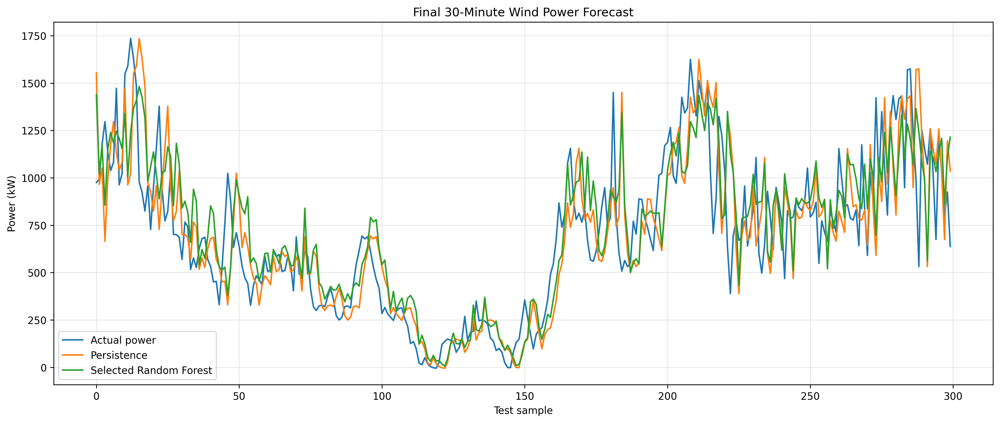
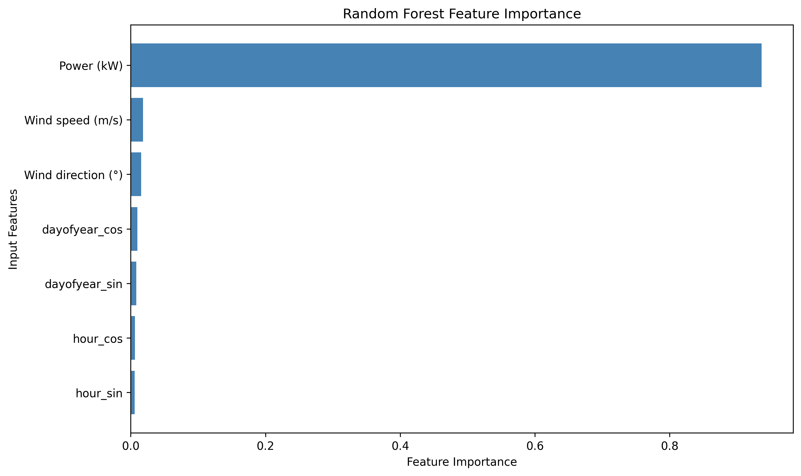

# Interpretable Wind Power Forecasting

## Project Overview

This project investigates interpretable short-term wind power forecasting using supervisory control and data acquisition (SCADA) measurements from the Kelmarsh wind farm.

The objective is to predict wind turbine power output **30 minutes ahead** and compare a Random Forest regression model against a simple Persistence Baseline.

The project emphasizes chronological evaluation, reproducibility, and model interpretability through feature importance analysis.

## Dataset

- **Source:** [Kelmarsh SCADA Dataset — Zenodo](https://zenodo.org/records/16807551)
- **Dataset file:** `Kelmarsh_SCADA_2020_3086.zip`
- **Turbine:** Kelmarsh Turbine 1
- **Year:** 2020
- **Sampling interval:** 10 minutes
- **Forecast horizon:** 30 minutes
- **Usable observations after preprocessing:** 52,170

The dataset is not included in this repository. It can be downloaded from the public Zenodo record.

## Methodology

### Data Preprocessing

The notebook performs the following steps:

1. Loads the turbine SCADA data from the ZIP archive.
2. Converts timestamps and measurement columns into appropriate data types.
3. Sorts observations chronologically and removes duplicate timestamps.
4. Creates the 30-minute-ahead prediction target using a three-step shift.
5. Removes observations with missing input features or target values.

### Input Features

Seven features are used for forecasting:

- Current power output (`Power (kW)`)
- Wind speed (`Wind speed (m/s)`)
- Wind direction (`Wind direction (°)`)
- `hour_sin`
- `hour_cos`
- `dayofyear_sin`
- `dayofyear_cos`

Cyclical time features represent daily and seasonal patterns.

### Chronological Data Split

The dataset is divided without random shuffling:

| Dataset | Percentage | Observations |
|---|---:|---:|
| Training | 60% | 31,302 |
| Validation | 20% | 10,434 |
| Testing | 20% | 10,434 |

The training set is used for fitting candidate models, the validation set for selecting hyperparameters, and the test set for final evaluation.

### Forecasting Models

**Persistence Baseline:** Uses the current power output as the prediction for 30 minutes ahead.

**Random Forest Regressor:** Three configurations are evaluated on the validation set. The configuration with the lowest validation MAE is selected.

The selected hyperparameters are:

| Hyperparameter | Value |
|---|---|
| `n_estimators` | 200 |
| `max_depth` | None |
| `min_samples_leaf` | 5 |
| `random_state` | 42 |

The selected model is retrained using the combined training and validation data before final testing.

## Final Test Results

| Model | MAE (kW) | RMSE (kW) | R² |
|---|---:|---:|---:|
| Persistence Baseline | **153.3288** | 240.8083 | 0.8757 |
| Random Forest | 165.9813 | **239.3336** | **0.8772** |

The Persistence Baseline achieves the lower MAE, while Random Forest achieves a slightly lower RMSE and a slightly higher R².

These results show that the Random Forest model does not outperform Persistence on every metric.

## Model Interpretability

Random Forest feature importance is used to examine which input variables contribute most to the model.

Current power output is the dominant feature, with an importance score of approximately **0.9364**. Wind speed, wind direction, and cyclical time features have smaller importance scores.

Feature importance describes model behavior and should not be interpreted as proof of causation.

## Visualizations

### Final Forecast Comparison

### Random Forest Feature Importance

## How to Run the Notebook

1. Download the dataset ZIP file `Kelmarsh_SCADA_2020_3086.zip` from the [Zenodo dataset page](https://zenodo.org/records/16807551).
2. Open `Interpretable_Wind_Power_Forecasting_Final.ipynb` in Google Colab.
3. Run the notebook cells in order.
4. When prompted by the upload cell, upload the downloaded ZIP file from your computer.
5. Continue running the cells to reproduce preprocessing, model training, evaluation, and visualizations.

The notebook uses Google Colab's file upload functionality. **Access to the author's personal Google Drive is not required.**

The dataset upload must be repeated if the Colab runtime is restarted.

## Repository Files

| File | Description |
|---|---|
| `Interpretable_Wind_Power_Forecasting_Final.ipynb` | Complete Google Colab notebook |
| `validation_results.csv` | Random Forest validation results |
| `final_test_results.csv` | Final test evaluation metrics |
| `final_feature_importance.csv` | Random Forest feature importance scores |
| `final_forecast_comparison.png` | Actual vs predicted power comparison |
| `final_feature_importance.png` | Feature importance visualization |
| `README.md` | Project documentation |

## Tools and Libraries

- Python
- Google Colab
- pandas
- NumPy
- scikit-learn
- Matplotlib

## Conclusion

This project demonstrates an interpretable workflow for 30-minute-ahead wind power forecasting using real-world SCADA measurements.

The results highlight the importance of evaluating machine learning models against strong simple baselines. Although Random Forest slightly improves RMSE and R², Persistence performs better in terms of MAE.
